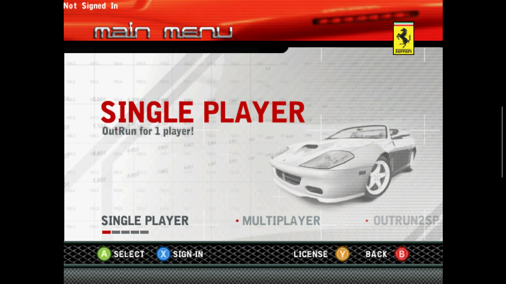

# 📱 OutRun 2006 Coast 2 Coast — Community Native Android Port

  
  
  
  

> [!NOTE]
> **Native Android-Only Fork**: This repository is a community-driven fork dedicated **exclusively to the native Android (`arm64-v8a`) handheld port** (verified on the Retroid Pocket 5 / Snapdragon 865 / Adreno 650).
>
> * **Android Releases Only**: We do **not** publish Windows, macOS, Switch, PS5, or Xbox releases from this repository. For other platforms and upstream decompilation work, visit [r4dius/outrun2-decomp](https://github.com/r4dius/outrun2-decomp).
> * **Handheld-Specific Optimizations**: All downstream changes and optimizations (persistent Android Vulkan pipeline cache, 60 Hz VSync FIFO frame pacing, Xbox C2C force-feedback haptics, edge-triggered `Vibrator` IPC, dynamic `/storage/*` MicroSD discovery, Adreno `VUID-00282` scissor clamping, and `WindowInsetsController` immersive mode) are built specifically for the Android handheld environment.

---

# Status #

This Android port is actively developed; while core gameplay is playable at 1080p 60 FPS on Snapdragon 865 / Adreno 650 handhelds, some upstream gameplay bugs and visual/menu edge cases are still being resolved.

The following enhancements (including the [emoose/OutRun2006Tweaks](https://github.com/emoose/OutRun2006Tweaks) suite) are **already integrated**:
- **OutRun2006Tweaks Suite**: `UseHiDefCharacters`, `DisableStageCulling`, `DisableVehicleLODs`, `FixRightSideBunkiAnimations`, `FixIncorrectShading`, `FixLensFlarePath`, `FixBinkLargeMovies`, `FixFullPedalChecks`, `FixZBufferPrecision`, and `FixPegasusClopping`.
- **Android Handheld Features**: Native 1080p Vulkan renderer, persistent Vulkan pipeline cache, Xbox C2C force-feedback haptics, 16:9 widescreen, and multiple anti-aliasing / resolution options.
- **Active Bug-Fix Roadmap**: Investigating and fixing remaining upstream gameplay issues (such as Coast 2 Coast rival drift scoring and end-of-race transition hangs) for upcoming Android releases.

# OutRun 2006 Coast 2 Coast: Native Android Port

   
  <b>Native Android Handheld Port (arm64-v8a / Vulkan)</b> 
  <i>Verified at 1080p 60 FPS on Retroid Pocket 5 (Snapdragon 865 / Adreno 650)</i>

### What Makes This Android Fork Different

| Feature | Android Handheld Implementation |
| :--- | :--- |
| **Vulkan Pipeline Cache** | Persists compiled pipelines in app-private storage (`OR2_PS5_VK_CACHE`), warming cached shaders in `< 1 ms` on relaunch |
| **Frame Pacing** | 60.00 Hz VSync FIFO present mode with microsecond steady-clock pacing to prevent physics fast-forward |
| **Force Feedback Haptics** | Xbox C2C `CalcVibrationValues` engine (road rumble, strips, tire slip, gear shifts, collisions) with edge-triggered `Vibrator` teardown |
| **Adreno / Mobile Safety** | Vulkan scissor rect clamping (`VUID-00282`), robust sleep/wake swapchain recovery, and `WindowInsetsController` immersive mode |
| **Zero-Config Storage** | Dynamic `/storage/*` MicroSD scan (supports any SD card UUID) + `sensorLandscape` orientation |
| **OutRun2006Tweaks** | `UseHiDefCharacters`, `DisableStageCulling`, `DisableVehicleLODs`, `FixRightSideBunkiAnimations`, `FixIncorrectShading`, `FixFullPedalChecks`, `FixZBufferPrecision`, `FixPegasusClopping` |

A native Android port of the PC version of OutRun 2006 Coast 2 Coast (Sumo Digital / Sega, 2006) based on the C++ decompilation/reconstruction by [r4dius](https://github.com/r4dius/outrun2-decomp).

This repository holds code only. **It contains no game data and no part of
the original executable.** To play, you need your own copy of the game
(Steam version).

## What you need from your game

- Copy your **OutRun 2006 Coast 2 Coast** PC (Steam) installation folder (including `OR2006C2C.EXE`, `Media/`, `Cars/`, etc.) manually onto your Android device into one of these auto-scanned paths:
  - `<MicroSD>/ROMs/ports/outrun2006/` *(recommended — any SD card UUID is detected automatically)*
  - `/sdcard/ROMs/ports/outrun2006/`
  - `/sdcard/Android/data/org.outrun2.c2c/files/`
- On first launch, the port reads code tables and constants from `OR2006C2C.EXE`, checks every range against SHA-256 hashes (`src/system/exe_image_ranges.inc`), and generates `OR2006C2C.cache` in that folder. Later launches only read the cache.

The game files are read in place and never modified; `OR2006C2C.cache` can be
deleted at any time and is rebuilt at the next launch.

## Layout

| Folder | Content |
| --- | --- |
| `src/driving`, `src/platform` | the game code, ported function by function (`*_tr.cpp`: code still translated from x86) |
| `src/*.cpp` (`control`, `asset_views`, `pc_pmt`) | input control, asset views and the PC model (PMT) loader shared by the game code |
| `src/recomp` | runtime of the translated code (`x86rt.hpp`: guest registers, memory, flags) |
| `src/system` | files, clocks, EXE image loading and checking, first-launch setup screen |
| `src/ports` | in-memory extraction of the Steam `OR2006C2C.EXE` (see its `README.md`) |
| `src/runtime` | the shared game runner (`game_host`) used by every platform |
| `src/input` | pad and lifecycle adapter shared by the Mac and PS5 builds |
| `src/enhancements` | port additions kept apart from the reconstructed game: extra Options > Settings rows (aspect ratio, resolution, anti-aliasing, frame rate); each platform lists what it supports (`enhancements_*.cpp` in its `source/`) |
| `switch/`, `mac/`, `ps5/`, `xbox/`, `android/` | one folder per platform, same layout in each |
| `tests/` | unit and regression tests (CTest) |
| `tools/` | EXE image tools, leak check, x86 translator, decompilation tracking, generators, PS5 build and package scripts |
| `images/` | screenshots |

Each platform folder has `source/` (platform code), `tests/`, `tools/`,
`third_party/` where needed, its build file and a `README.md` on how to
build and install it. Shader sources are in `switch/shaders` and
`ps5/shaders`; the Mac, PS5 and Xbox builds generate their shaders from
them (Metal, SPIR-V, HLSL). `ps5/title` builds the PS5 native title,
`ps5/sce_sys` holds its tile and backgrounds, `xbox/package` the UWP
manifest and logos.

`icon.png` and `bg.png` are the project's icon and background.
`tools/make_icons.ps1` derives each platform's images from them, at the
size and format each one expects: the Switch NRO icon, the PS5 tile and
backgrounds, the Xbox package logos and the Mac application icon.

## Building

| Platform | Command | Details |
| --- | --- | --- |
| Android (Handhelds) | `cd android && ./gradlew assembleRelease` | `android/README.md` |
| Nintendo Switch | `make -C switch` | `switch/README.md` |
| macOS | `cmake --preset mac-full` | `mac/README.md` |
| PS5 | `Build-PS5.ps1` (Windows + WSL; makes the `.pkg`) | `ps5/README.md` |
| Xbox | `cmake` with `-DOR2_XBOX=ON` (Visual Studio 2026, UWP) | `xbox/README.md` |

Linux host (runner and tests):

    cmake -S . -B build -G Ninja -DOR2_EXE=<your OR2006C2C.EXE> \
        -DOR2_PC_ASSET_ROOT=<your game folder>
    cmake --build build
    ctest --test-dir build

Tests that need the game files take them from these two settings.

## Leak check

`tools/leak_check.py <your OR2006C2C.EXE> <built binary> --allow tools/leak_check_allow.txt`
verifies that no byte run of the original executable is compiled into a binary.

## Credits

Inspired and using tweaks by [OutRun2006Tweaks](https://github.com/emoose/OutRun2006Tweaks)
by emoose. See `THIRD_PARTY_NOTICES.md`.

OutRun is a trademark of Sega. This project is not affiliated with or endorsed by Sega or Sumo Digital.

This source code is be freely available for use, modification, and redistribution, subject to the licenses of the original projects it is based on.

Feel free to reuse any part of this project in your own work. Please give proper credit where due.

If you reuse our modifications, please keep an appropriate reference to this project and its contributors.
